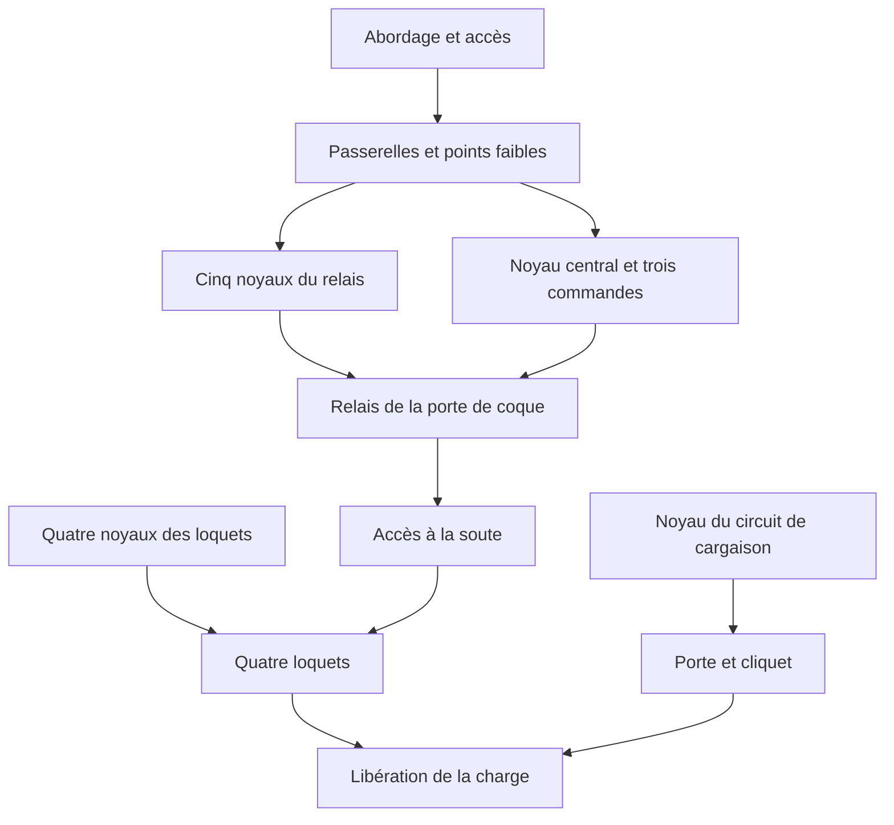

# Frégate et Empereur références pour la reconstruction 3D

> **Révision après retour utilisateur, 10 novembre 2026 :** la première reconstruction de l’Empereur a été rejetée et la maquette intacte reste non fidèle. La version couchée désigne l’épave jouable de Pendola : ses accès et ses volumes intérieurs doivent contraindre la coque dès la reconstruction. Voir [l’étude corrigée](EMPEROR_FORME_INTACTE.md), [les captures de Pendola](emperor-pendola.html) et [les références du marcheur](emperor-intact.html). Le texte ci-dessous conserve le relevé initial ; ses hypothèses de forme et de parcours ne valent pas validation.

Relevé du 10 novembre 2026 pour Speranza Ops. Cible : la Frégate abordable et l’Empereur échoué du Col de Pendola, avec leurs espaces intérieurs et leurs mécanismes.

La Frégate dispose d’un export communautaire détaillé permettant de retrouver la géométrie et les placements. L’Empereur dispose ici de références de gameplay, mais pas d’une scène complète mesurée. Une reproduction **identique au jeu actuel** ne peut donc pas encore être certifiée : l’export Frégate porte une ancienne étiquette de build, ses matériaux sont simplifiés et plusieurs faces de l’Empereur restent hors champ.

Lors du relevé initial, les modèles n’avaient pas été remplacés. L’intégration a ensuite été commencée : la Frégate utilise la géométrie source ; la reconstruction de l’Empereur a été retirée après rejet. Les captures de salles restent utilisables indépendamment de ce modèle.

## Ce que contient le dossier

| Ensemble | Contenu conservé | Usage |
| --- | --- | --- |
| Frégate | 51 fichiers GLB, 82 textures KTX2 au niveau medium, 24 images de coupes, 12 fichiers de données | Géométrie, placements, matériaux, mécanismes et navigation |
| Frégate | 4 captures du visualiseur communautaire | Lecture de silhouette et de coupes ; rendu distinct de celui du jeu |
| Frégate | 1 capture de gameplay de Topside Gamer à 1:07 | Surface de plateforme et échelle humaine ; ne valide pas la porte de cargaison |
| Empereur | 23 images et une courte vidéo de référence | Coque, trappe, puits, salles, éclairage et accessoires |
| Vidéos | 3 visites originales indexées, avec chapitres | Relevés complémentaires par zone |
| Données dérivées | Inventaire, connexions des noyaux, coupes et cadrages | Préparation de l’assemblage et des contrôles |

Les 169 ressources Frégate représentent 23 370 591 octets, environ 22,3 Mio. Leurs empreintes SHA-256 et leurs URL sont dans [l’inventaire de provenance](<C:/Dev/Arc Raiders/Speranza_Ops/research/operations-3d/frigate-source-integrity.json>). Le cache couvre les 51 maillages utilisés par les instances visibles de la scène ; il ne couvre pas tous les LOD, ennemis supplémentaires ou collisions mentionnés par le manifeste général.

## Sources et niveau de preuve

| Source | Ce qu’elle établit | Limite |
| --- | --- | --- |
| [ARC Tracker, visite de la Frégate](https://arctracker.io/guides/frigate-cargo-run) | Scène consultable, formes, placements, données techniques | Export communautaire ; plusieurs effets sont inférés |
| [Présentation par zeetu](https://www.reddit.com/r/ArcRaiders/comments/1x3balr/oc_interactive_3d_frigate_event_guide/) | L’auteur indique que les modèles proviennent du jeu | Déclaration de provenance, pas certification d’Embark |
| [Manifeste du modèle](https://assets.arctracker.io/guides/frigate/builds/2.00.0-CL1418508.b8ec35f676d6375c.json) | Version annoncée, ressources et variantes de texture | Étiquette `2.00.0-CL1418508` |
| [Embark 2.0](https://arcraiders.com/news/frozen-trail-2-0-update) | Contexte de sortie Frozen Trail du 8 octobre 2026 | Pas un plan technique des machines |
| [Embark 2.2](https://arcraiders.com/news/store-update-2-2-0) et [2.3](https://arcraiders.com/news/live-update-2-3-0) | Changements de mécanismes, collisions, portes et butin | Nécessitent des images récentes pour reconstruire les détails modifiés |
| [Arc Raiders Hub, Empereur](https://arcraidershub.com/guides/fallen-emperor-guide) | Captures de ses parties et de créateurs crédités ; synthèse de parcours | Article daté du 9 octobre ; mesures absentes |
| [Raider Logic, toutes les salles](https://www.youtube.com/watch?v=JLBVTdaahLQ) | Gameplay original, repères de salles et de traversée | Quelques images inspectées, pas un relevé exhaustif de toutes les variantes |
| [Gamer Guides, Empereur](https://gamer-guides.com/arc-raiders/emperor/) | Vue extérieure large de l’épave | Perspective, neige et relief masquent des formes |

L’actualisation officielle du [10 novembre 2026, version 2.5.0](https://arcraiders.com/news/store-update-2-5-0), annonce des variantes cosmétiques. Elle ne fournit pas de nouveau relevé géométrique de ces deux machines.

## Frégate extérieur

### Silhouette et masses

La vue 3D montre un bâtiment large et aplati, organisé autour d’un axe longitudinal. Quatre grands ensembles circulaires de propulsion structurent les côtés. Les carénages se raccordent à des ailes épaisses, avec de longues nervures, des cavités et des appendices arrière. Le pont possède des changements de niveau marqués ; il ne doit pas devenir une simple dalle sur laquelle poser quelques accessoires.

Cette image est une capture du [visualiseur](https://arctracker.io/guides/frigate-cargo-run), pas du jeu. La [capture de gameplay déjà présente dans le projet](<C:/Dev/Arc Raiders/Speranza_Ops/assets/bestiary/arc-frigate.webp>) sert de contrôle pour la silhouette en contre-plongée et les jets de propulsion.

Le fichier `scene.json` donne une boîte englobante de **372,313 × 92,213 × 250,514**, dans l’ordre X/Y/Z de l’export. Y est vertical dans le visualiseur. Ces valeurs sont des mesures de la scène exportée, pas des dimensions officielles publiées par Embark. Le rapport longueur/largeur est d’environ 1,49. Conserver ces rapports avant toute mise à l’échelle pour l’interface.

### Pièces à conserver séparées

| Famille | Ressources repères | Rôle dans la reconstruction |
| --- | --- | --- |
| Coque | `SM_Frigate_Front_01`, `Rear_01`, `Rear_02` | Volumes principaux et raccords entre ponts |
| Flancs | `SideFront_01`, `SideFront_R_01`, `SideRear_01/02` et versions R | Silhouette, creux latéraux et accès |
| Propulsion | `Thruster_01`, `ThrusterRear_01`, `01_ThrusterNozzle_01` | Tuyères, couronnes et volumes sous le vaisseau |
| Abordage | `Docking_01_A` | Structure d’amarrage sous la coque |
| Soute | `InteriorCargo_01_A`, `SK_Frigate_Cargo_01_A` | Enveloppe intérieure et charge mobile distinctes |
| Mécanismes | `SlidingDoor`, `CargoLatch`, `ProgressHatch`, `Platform`, `Fan` | Objets mobiles avec pivots et états propres |

Les versions gauche/droite sont des ressources distinctes. Ne pas remplacer automatiquement un côté par une copie miroir : les nombres de triangles et certaines bornes diffèrent. Les détails sont listés dans [l’inspection géométrique](<C:/Dev/Arc Raiders/Speranza_Ops/research/operations-3d/frigate-inspection.json>).

### Matériaux

La scène exportée référence 68 matériaux. Leurs paramètres incluent couleur, rugosité, métal, normales, émission, masques et échelle des UV. Les GLB seuls contiennent des matériaux de remplacement : charger simplement un GLB dans Blender ne restitue pas ces surfaces.

Les notes de 61 matériaux signalent au moins une simplification, une valeur neutre ou une inférence. Plusieurs couches de poussière, normales de détail, mélanges par sommet et projections de texture dans le monde ont été omises. Ces notes sont conservées dans [materials.json](<C:/Dev/Arc Raiders/Speranza_Ops/research/operations-3d/source/frigate/materials.json>). Il faudra comparer les surfaces en gros plan au gameplay avant de valider le rendu.

## Frégate intérieur et game design

### Organisation spatiale

Conserver les accès d’amarrage, les passerelles mobiles, les espaces autour du noyau central, les salles latérales, la soute et les passages des ventilateurs. La soute est un volume réel avec une charge centrale, des accès périphériques et des mécanismes au niveau du sol ; elle ne se résume pas à une boîte décorative sous le vaisseau.

Les données comprennent **513 instances de maillage visibles**, 115 lumières et 39 emplacements de génération. Ces chiffres décrivent l’export, pas des ennemis présents simultanément. Les 51 maillages visibles uniques totalisent 1 144 616 triangles ; après multiplication par les instances, l’inventaire atteint environ 2,30 millions de triangles.

Les 11 niveaux de coupe du visualiseur ont été calculés automatiquement à partir de la géométrie. Ce ne sont pas « onze étages officiels ». Les hauteurs et les vues plan/profil sont conservées pour inspecter les circulations, dans [les coupes](<C:/Dev/Arc Raiders/Speranza_Ops/research/operations-3d/frigate-deck-cuts.json>) et le dossier `source/frigate/data/decks`.

### Graphe fonctionnel à reproduire

Le fichier de câblage identifie **11 acteurs de noyau et 26 boucliers**, ainsi que des points faibles distincts. Il relie cinq noyaux et le noyau central au relais de la grande porte. Quatre autres noyaux alimentent les loquets ; le dernier commande le circuit de la porte de cargaison et du cliquet.

Ce graphe est la meilleure base technique disponible, mais **117 de ses 144 effets de connexion sont marqués `inferred` par l’exporteur**. Il faut conserver cette distinction lors de l’implémentation. [Connexions détaillées](<C:/Dev/Arc Raiders/Speranza_Ops/research/operations-3d/frigate-core-connections.json>) et [source complète](<C:/Dev/Arc Raiders/Speranza_Ops/research/operations-3d/source/frigate/data/wiring.json>).

Ce diagramme résume les dépendances de l’export ; il n’impose pas un ordre de déplacement unique aux joueurs.

| Mécanisme | Valeur ou structure relevée | Conséquence pour le modèle |
| --- | --- | --- |
| Noyau central | 3 interactions, 4 boucliers ; montée de 20 s dans `anims.json` | Préserver la course, le pivot et les pièces emportées |
| Porte de coque | Deux vantaux ; séquence de 25 s dans l’export | Animations locales distinctes, y compris échelles miroir |
| Loquets | 4 ensembles ; 2 interactions par loquet ; maintien 1,5 s | Interactions accessibles et deux états mécaniques visibles |
| Cliquet | 2 interactions ; 4 validations ; délai de pas 2,2 s | Course séquencée, sans remplacer les étapes par une rotation décorative |
| Libération | Délai 2 s ; séquence de libération 10 s | Charge indépendante du bâtiment |
| Ventilation | 4 ventilateurs, répartis entre 2 zones dangereuses | Rotation, obstacles et états de danger distincts |
| Portes à points faibles | 4 portes liées chacune à 4 points faibles | Cibles séparées de la porte et du décor |

Ces valeurs proviennent des fichiers exportés. Elles ne sont pas présentées comme une mesure effectuée dans une partie en version 2.5.

### Écarts avec le dossier actuel du site

Le texte actuel annonce 20 noyaux extérieurs et 8 intérieurs. L’export compte autrement et ne permet pas de justifier ce total. La différence ne se résout pas simplement en renommant les boucliers : il faut suivre chaque composant et sa conséquence. Garder séparés **noyau, bouclier, point faible, entrée du relais et loquet**.

Embark indique en 2.3 une nouvelle version de la porte de cargaison, de nouvelles trappes de progression et des corrections de collision. La présence d’un maillage `ProgressHatch` dans un export étiqueté 2.0 ne prouve pas que cet export correspond à la révision 2.3. La porte et les indicateurs doivent donc être contrôlés sur une capture récente. [Embark 2.3](https://arcraiders.com/news/live-update-2-3-0)

La 2.2 a également corrigé l’éjection des Raiders pendant la descente, les zones d’écrasement et les brûlures près de l’atterrissage. La simulation de la cargaison doit représenter ces états séparément. [Embark 2.2](https://arcraiders.com/news/store-update-2-2-0)

## Empereur extérieur

### Posture à reproduire

La cible est l’épave implantée dans le relief de Pendola. Les captures montrent une masse centrale avec un grand raccord circulaire, deux structures rectangulaires saillantes, des articulations cylindriques et des membres très longs. Les sections supérieures portent de la neige ; des faisceaux de câbles pendent près des articulations. La posture et l’enfoncement dans la pente sont essentiels à la silhouette.

La [vue extérieure large](<C:/Dev/Arc Raiders/Speranza_Ops/research/operations-3d/references/emperor/emperor-exterior-wide.webp>) de [Gamer Guides](https://gamer-guides.com/arc-raiders/emperor/) confirme cette organisation. Elle ne montre pas assez l’arrière, le dessous et les extrémités pour établir une enveloppe complète. Le nombre de membres visibles sur une seule image ne doit pas devenir le nombre de membres du modèle.

Les vues [du dessus](<C:/Dev/Arc Raiders/Speranza_Ops/research/operations-3d/references/emperor/emperor-top.webp>) et [du membre parcouru en tyrolienne](<C:/Dev/Arc Raiders/Speranza_Ops/research/operations-3d/references/emperor/emperor-zipline.webp>) montrent de grandes surfaces de carénage continues, des joints fins et des raccords arrondis. Éviter de transformer ces pièces en poutres rectangulaires uniformes. Captures publiées par Arc Raiders Hub, crédits individuels dans l’index de références.

### Entrée et détails proches du joueur

La trappe circulaire possède une bordure épaisse, des renforts en croix et des plots saillants. La prise du conduit est un élément local de la coque, distinct de l’ouverture praticable. Les images [trappe ouverte](<C:/Dev/Arc Raiders/Speranza_Ops/research/operations-3d/references/emperor/emperor-hatch-open.webp>) et [prise](<C:/Dev/Arc Raiders/Speranza_Ops/research/operations-3d/references/emperor/emperor-door.webp>) doivent servir au relevé des proportions et de la position du joueur. Une capture oblique ne suffit pas à mesurer le diamètre ou l’axe d’ouverture.

## Empereur intérieur et game design

L’entrée et le hangar final sont des repères fixes ; les salles intermédiaires varient. Arc Raiders Hub rapporte six configurations dans les fichiers et environ une douzaine d’épreuves. Ce nombre reste une affirmation du guide, sans fichier de disposition joint ici. Les « 8 épreuves » du site ne constituent donc pas un plan topologique vérifié. [Guide Empereur](https://arcraidershub.com/guides/fallen-emperor-guide)

Les observations suivantes concernent les formes visibles sur les captures conservées. Les modules sont des unités de production proposées, pas les noms officiels d’une scène du jeu.

| Module | Formes observables à reproduire | Référence visuelle locale |
| --- | --- | --- |
| Tunnel d’entrée | Paroi cylindrique striée, neige au sol, blocs techniques inclinés, éclairs bleus | [Tunnel](<C:/Dev/Arc Raiders/Speranza_Ops/research/operations-3d/references/emperor/emperor-electrified-boxes.webp>) |
| Puits principal | Couronnes métalliques superposées, vide central, surfaces segmentées, larges anneaux sombres | [Puits](<C:/Dev/Arc Raiders/Speranza_Ops/research/operations-3d/references/emperor/emperor-interior-ring-hall.webp>) |
| Passages | Portes à angles arrondis, panneaux métalliques, câbles au sol, luminaires latéraux | [Passage jaune](<C:/Dev/Arc Raiders/Speranza_Ops/research/operations-3d/references/emperor/emperor-wrong-door-yellow-light.webp>) |
| Puits à conteneur | Long module équipé de rangées d’alvéoles circulaires et de vérins, encadrement sombre | [Conteneur](<C:/Dev/Arc Raiders/Speranza_Ops/research/operations-3d/references/emperor/emperor-moving-container.webp>) |
| Descente | Paroi cylindrique nervurée, planchers annulaires découpés, axe central et échelle | [Descente](<C:/Dev/Arc Raiders/Speranza_Ops/research/operations-3d/references/emperor/emperor-chasm-drop.webp>) |
| Labyrinthe | Cloisons hautes, câbles jaunes, sol modulaire à motifs ronds et cruciformes | [Labyrinthe](<C:/Dev/Arc Raiders/Speranza_Ops/research/operations-3d/references/emperor/emperor-maze.webp>) |
| Montée | Puits étroit, échelles longues, bandes rouges et ouvertures circulaires éclairées | [Échelles](<C:/Dev/Arc Raiders/Speranza_Ops/research/operations-3d/references/emperor/emperor-ladder-climb.webp>) |
| Lasers | Grand volume courbe, modules techniques en travers, faisceaux violets à différentes hauteurs | [Lasers](<C:/Dev/Arc Raiders/Speranza_Ops/research/operations-3d/references/emperor/emperor-laser-trap-room.webp>) |
| Hangar | Parois inclinées à équipements encastrés, conteneur effondré, capsules, sol rainuré | [Hangar](<C:/Dev/Arc Raiders/Speranza_Ops/research/operations-3d/references/emperor/emperor-loot-hangar.webp>) |
| Ouverture supérieure | Grande ouverture ronde vers le ciel, cadre concentrique, éclairage rouge | [Ouverture](<C:/Dev/Arc Raiders/Speranza_Ops/research/operations-3d/references/emperor/emperor-hangar-opens-arc.webp>) |
| Réceptacle de butin | Disque encastré à ouverture locale et mécanisme de forçage | [Réceptacle](<C:/Dev/Arc Raiders/Speranza_Ops/research/operations-3d/references/emperor/emperor-wall-panel-breach.webp>) |

Les cinq images prises dans la vidéo de Raider Logic ajoutent des contrôles indépendants : tunnel enneigé à 0:28, équipement circulaire à 4:06, passage du compacteur à 6:55, géométrie de la salle sombre à 15:00, équipements du secteur final à 24:40. Elles ne permettent pas de déduire les dimensions de toutes les salles ni leur ordre global. [Visite originale](https://www.youtube.com/watch?v=JLBVTdaahLQ)

### Mécanismes et lisibilité

Le guide relie l’entrée au conduit, décrit des obstacles électriques temporairement neutralisables, un ascenseur, des parois de compression, des conteneurs mobiles et des lasers. Il distingue les lumières blanches de progression des portes jaunes de retour ou de sortie. Le hangar comporte six cibles de commande. Ces fonctions demandent des objets et des états distincts. [Guide Empereur](https://arcraidershub.com/guides/fallen-emperor-guide)

La couleur des surfaces ne suffit pas à représenter un danger : prévoir séparément mouvement, effet électrique, volume déclencheur et collision. Les synchronisations de plateformes ont changé en 2.2 ; les volumes mortels du compacteur et des collisions ont été corrigés en 2.3. Les vidéos anciennes ne doivent pas servir à reproduire ces bugs. [Embark 2.2](https://arcraiders.com/news/store-update-2-2-0), [Embark 2.3](https://arcraiders.com/news/live-update-2-3-0)

## Relevés encore nécessaires pour valider une copie identique

| Priorité | Relevé | Ce qu’il permettra de valider |
| --- | --- | --- |
| 1 | Empereur vu de face, profil, arrière, dessus et dessous, avec repères communs | Enveloppe, posture, membres et raccord au terrain |
| 1 | Parcours continus de plusieurs variantes de l’Empereur | Connexions réelles, hauteurs, portes et volumes superposés |
| 1 | Frégate récente, porte de cargaison et indicateurs de progression | Écart entre export étiqueté 2.0 et révision 2.3 |
| 2 | Gros plans de matériaux sous lumière neutre et en situation | Couleurs, rugosité, normales, neige, poussière et décals |
| 2 | Mécanismes filmés du début à la fin | Pivots, course, durée, déclencheurs et retour à l’état initial |
| 2 | Dimensions de plusieurs objets communs ou export mesuré de l’Empereur | Échelle absolue sans dépendre de la perspective |

Les repères vidéo sont disponibles dans [l’index vidéo](<C:/Dev/Arc Raiders/Speranza_Ops/research/operations-3d/video-reference-index.json>). Les URL, empreintes et horodatages des captures sont dans [l’index Empereur](<C:/Dev/Arc Raiders/Speranza_Ops/research/operations-3d/emperor-reference-index.json>).

La visite de Topside Gamer a été publiée le 3 novembre 2026. La [capture conservée à 1:07](<C:/Dev/Arc Raiders/Speranza_Ops/research/operations-3d/references/frigate-gameplay/frigate-platform.png>) documente une plateforme, ses panneaux et l’échelle des Raiders. La date de publication ne prouve pas la version du jeu enregistrée. Les indicateurs et la porte restent à contrôler ; leurs captures n’ont pas abouti dans le lecteur. [Vidéo originale](https://www.youtube.com/watch?v=XIQ2WTqWong&t=67s)

## Passage à la reconstruction

La Frégate peut commencer par un assemblage contrôlé de la géométrie conservée. Pour l’Empereur, commencer par les volumes visibles et les modules intérieurs documentés, en laissant explicitement non validées les connexions et les faces cachées. Le détail de production et les critères de réception figurent dans [la spécification 3D](<C:/Dev/Arc Raiders/Speranza_Ops/research/operations-3d/SPECIFICATION_3D.md>).

Crédits : univers et éléments du jeu © Embark Studios ; export et visualiseur Frégate ARC Tracker/zeetu ; captures de gameplay créditées à leurs auteurs dans les sources. Aucune licence de données tierce n’est attribuée par ce dossier aux modèles du jeu.
